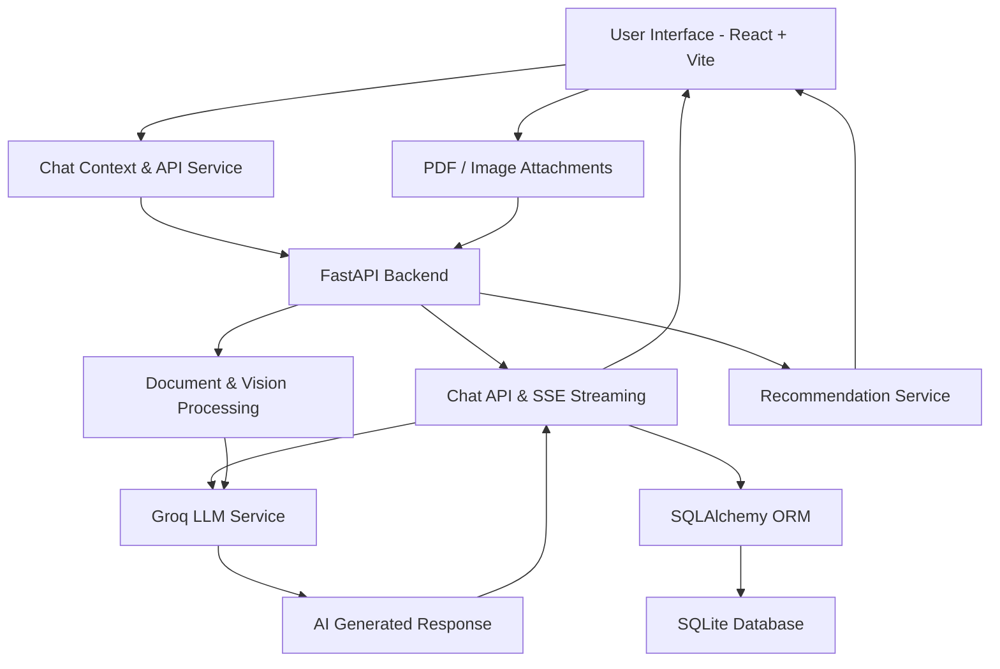

# ☪︎ Esmeray AI – Production Full Stack Conversational Chatbot

<p align="center">
  <strong>Your Intelligent AI Companion for Conversations, Documents & Developer Assistance</strong>
</p>

<p align="center">
  A full-stack AI conversational platform inspired by the ChatGPT desktop experience, combining React, FastAPI, Groq LLM inference, SQLite persistence, and multimodal document understanding into a responsive AI application.
</p>

<p align="center">
  <a href="https://conversational-chatbot-gamma.vercel.app/"><strong>🌐 Live Application</strong></a> |
  <a href="https://github.com/Sravanth-Kumar-Kuricheti/Conversational-Chatbot"><strong>📂 Source Code</strong></a>
</p>

<p align="center">
  
  
  
  
  
  
</p>

---

## 🧠 Vision & Problem Statement

Traditional conversational applications often lack persistent conversation management, real-time response generation, document understanding, and contextual recommendations in one unified experience.

**Esmeray AI** is designed to provide a modern AI interaction platform that combines intelligent conversations with persistent chat history and multimodal input capabilities.

The application uses Groq-powered language models for AI inference, FastAPI for backend services, SQLite for conversation persistence, and React for a responsive ChatGPT-inspired user interface.

The goal is to create a practical AI assistant that supports everyday conversations, document-based questions, image understanding, and contextual developer recommendations.

---

## 🚀 Key Differentiators & Features

| Capability | What It Does | Why It Matters |
|---|---|---|
| Real-Time AI Streaming | Streams generated responses using Server-Sent Events | Faster conversational experience |
| Persistent Chat History | Saves conversations and messages in SQLite | Conversations survive refreshes |
| Conversation Management | Search, rename, and delete conversations | Better organization |
| Multimodal Attachments | Accepts PDF and image uploads | Supports multiple input formats |
| PDF Understanding | Extracts document text using PyPDF | Enables document-based questions |
| Image Understanding | Uses image processing and Groq vision capabilities | Supports visual queries |
| Smart Auto-Scroll | Tracks streaming output and pauses when users scroll upward | Better reading experience |
| AI Recommendations | Provides contextual recommendations and action checklists | More useful responses |
| Suggested Questions | Displays clickable follow-up prompts | Improves interaction |
| Code Formatting | Displays formatted code with syntax highlighting and copy actions | Developer-friendly responses |
| Responsive Interface | Collapsible sidebar and mobile-friendly layout | Better usability |

---

## 🏗️ System Architecture

Esmeray AI follows a modular full-stack architecture that separates frontend interaction, backend API processing, AI inference, and persistent storage.



### 🔄 Request Processing Workflow

1. **User Interaction:** The user submits a message through the React chat interface.
2. **API Communication:** The frontend sends the request to the FastAPI backend.
3. **AI Processing:** The backend communicates with the configured Groq language model.
4. **Response Streaming:** Server-Sent Events deliver generated tokens to the frontend.
5. **Database Persistence:** Conversation threads and messages are stored using SQLAlchemy and SQLite.
6. **Multimodal Processing:** PDF and image attachments are processed through their respective extraction and vision workflows.
7. **Recommendation Generation:** Contextual recommendations and related resources are presented in the interface.

---

## 🛠️ Technology Stack

| Layer | Technology | Purpose |
|---|---|---|
| Frontend Framework | React.js | Interactive user interface |
| Build Tool | Vite | Frontend development and build |
| Styling | Tailwind CSS | Responsive UI styling |
| Programming Language | Python | Backend development |
| Backend Framework | FastAPI | REST API development |
| AI Integration | Groq Python SDK | LLM inference |
| Language Model | Llama 3.3 70B Versatile | Conversational AI |
| Database | SQLite | Persistent conversation storage |
| ORM | SQLAlchemy | Database operations |
| Validation | Pydantic v2 | Request and response validation |
| Streaming | Server-Sent Events (SSE) | Real-time response delivery |
| PDF Processing | PyPDF | PDF text extraction |
| Image Processing | Pillow | Image processing |
| Vision AI | Groq Multimodal Vision API | Image understanding |
| Deployment | Vercel & Render | Frontend and backend hosting |
| Version Control | Git & GitHub | Source code management |

---

## 📂 Project Structure

```text
Conversational-Chatbot/
│
├── backend/
│   ├── app/
│   │   ├── main.py
│   │   ├── config.py
│   │   ├── database.py
│   │   │
│   │   ├── models/
│   │   │   └── chat.py
│   │   │
│   │   ├── schemas/
│   │   │   └── chat.py
│   │   │
│   │   ├── routes/
│   │   │   └── chat.py
│   │   │
│   │   ├── services/
│   │   │   ├── groq_service.py
│   │   │   └── recommendation_service.py
│   │   │
│   │   └── utils/
│   │       └── helpers.py
│   │
│   ├── requirements.txt
│   ├── render.yaml
│   └── test_integration.py
│
├── frontend/
│   ├── src/
│   │   ├── components/
│   │   ├── context/
│   │   ├── hooks/
│   │   ├── services/
│   │   ├── pages/
│   │   ├── App.jsx
│   │   ├── main.jsx
│   │   └── index.css
│   │
│   ├── index.html
│   ├── package.json
│   ├── tailwind.config.js
│   └── vite.config.js
│
├── .gitignore
├── DEPLOYMENT.md
└── README.md
```

---

## ⚡ Quickstart Guide

### 1. Clone Repository

```bash
git clone https://github.com/Sravanth-Kumar-Kuricheti/Conversational-Chatbot.git

cd Conversational-Chatbot
```

### 2. Backend Environment Setup

```bash
cd backend

python -m venv venv
```

Activate the virtual environment:

**Windows PowerShell:**

```powershell
.\venv\Scripts\Activate.ps1
```

Install dependencies:

```bash
pip install -r requirements.txt
```

### 3. Configure Environment Variables

Create a `.env` file inside the backend directory.

```env
GROQ_API_KEY=gsk_your_groq_api_key_here

GROQ_MODEL=llama-3.3-70b-versatile

DEFAULT_MODEL=llama-3.3-70b-versatile

DATABASE_URL=sqlite:///./pychat.db

CORS_ORIGINS=http://localhost:5173,http://localhost:3000,http://127.0.0.1:5173
```

Replace the API key with your own Groq API key.

### 4. Run Backend API Server

```bash
python -m uvicorn app.main:app --host 127.0.0.1 --port 8000 --reload
```

Backend API:

```text
http://127.0.0.1:8000
```

Interactive API documentation:

```text
http://127.0.0.1:8000/docs
```

### 5. Run Frontend Application

Open another terminal:

```bash
cd frontend

npm install

npm run dev
```

Open the application:

```text
http://localhost:5173
```

---

## 🌐 Deployment Architecture

The project is deployed using separate frontend and backend hosting services.

| Component | Platform | Responsibility |
|---|---|---|
| Frontend | Vercel | React application hosting |
| Backend | Render | FastAPI backend hosting |
| AI Engine | Groq API | Language model inference |
| Database | SQLite | Conversation persistence |

### 🔗 Live Application

**Esmeray AI – Live Demo**

https://conversational-chatbot-gamma.vercel.app/

### 📖 Deployment Documentation

Refer to the repository's `DEPLOYMENT.md` for deployment configuration and instructions.

---

## 🔐 Environment & Security

- Store API keys in environment variables.
- Never commit `.env` files to GitHub.
- Configure production CORS origins appropriately.
- Keep database configuration separate from application logic.
- Protect API credentials and deployment secrets.

---

## 🚀 Future Enhancements

- Add Retrieval-Augmented Generation (RAG) for knowledge-base conversations.
- Expand document processing and contextual retrieval.
- Add additional AI model selection options.
- Introduce conversation export functionality.
- Improve multilingual conversational capabilities.
- Expand user authentication and personalization.

---

## 👨‍💻 Author

**Sravanth Kumar Kuricheti**

B.Tech – Artificial Intelligence & Data Science

- GitHub: https://github.com/Sravanth-Kumar-Kuricheti
- LinkedIn: https://www.linkedin.com/in/sravanthkumar/

---

<p align="center">
  ⭐ If you find this project useful, consider giving it a star!
</p>

**Esmeray AI | Full Stack Development | Generative AI | FastAPI | React | Groq**
